# Event Driven Architecture avec Kafka et Spring Cloud Stream

Activité pratique sur les architectures pilotées par les événements : Apache Kafka (en local puis avec Docker), Spring Cloud Stream (producer, consumer, supplier), traitement temps réel avec Kafka Streams et tableau de bord web.

Vidéo de référence : https://www.youtube.com/watch?v=8uY7JE_X_Fw

## Architecture

```
 Navigateur ── GET /publish?name=P1&topic=R2 ──► PageEventController (StreamBridge)
                                                        │
                                                        ▼
                                                   topic R2 ──► pageEventConsumer (affiche l'événement)

 pageEventSupplier (toutes les 200 ms) ──► topic R3 ──► kStreamFunction (Kafka Streams)
                                                          filtre durée > 100 ms
                                                          compte par page, fenêtre de 5 s
                                                          store "page-count"
                                                                │
                                                                ├──► topic R4 (page : nombre)
                                                                ▼
 index.html (courbes Smoothie) ◄── SSE GET /analytics ◄── InteractiveQueryService
```

| Élément | Rôle |
|---|---|
| `PageEvent` | Record : page visitée, utilisateur, date, durée |
| `PageEventController` | `/publish` (producer REST) et `/analytics` (flux SSE temps réel) |
| `pageEventConsumer` | Consumer : lit le topic R2 |
| `pageEventSupplier` | Supplier : produit un événement toutes les 200 ms dans R3 |
| `kStreamFunction` | Kafka Streams : visites par page sur des fenêtres de 5 s (R3 → R4) |
| `index.html` | Tableau de bord temps réel |

**Technologies :** Apache Kafka 3.9.1, Docker (Confluent 7.3.0), Spring Boot 4, Spring Cloud Stream 5, Kafka Streams, Server-Sent Events, Smoothie Charts.

---

## Partie 1 — Kafka en local

Kafka 3.9.1 extrait dans `C:\kafka`. Les commandes sont dans le dossier [`partie1-kafka-local`](partie1-kafka-local).

### Démarrer Zookeeper

```
bin\windows\zookeeper-server-start.bat config\zookeeper.properties
```

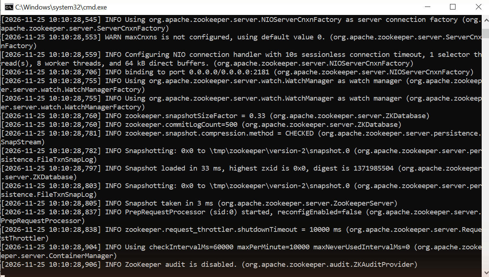

### Démarrer le serveur Kafka

```
bin\windows\kafka-server-start.bat config\server.properties
```

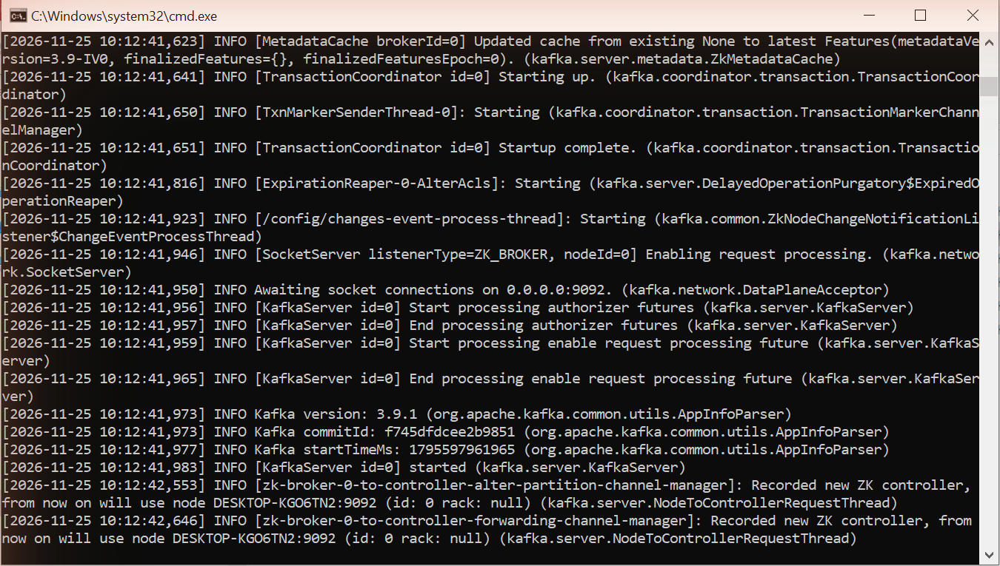

### Tester avec kafka-console-producer et kafka-console-consumer

```
bin\windows\kafka-topics.bat --create --topic R1 --bootstrap-server localhost:9092
bin\windows\kafka-console-consumer.bat --topic R1 --from-beginning --bootstrap-server localhost:9092
bin\windows\kafka-console-producer.bat --topic R1 --bootstrap-server localhost:9092
```

Chaque message tapé dans le producer (à gauche) est reçu par le consumer (à droite) :

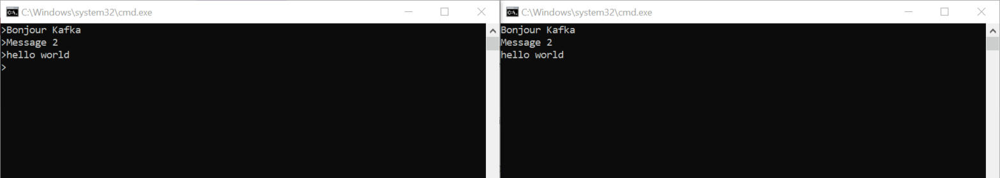

---

## Partie 2 — Kafka avec Docker

Fichier [`docker-compose.yml`](docker-compose.yml) : un conteneur `zookeeper` et un conteneur `broker` (Kafka exposé sur le port 9092).

```
docker compose up -d
docker ps
```

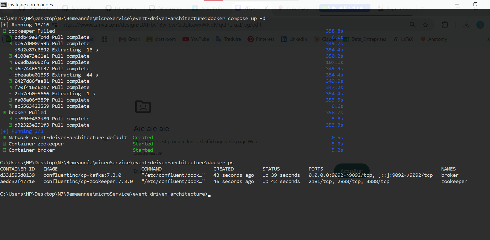

Test dans le conteneur :

```
docker exec -it broker kafka-console-consumer --bootstrap-server broker:9092 --topic R2 --from-beginning
docker exec -it broker kafka-console-producer --bootstrap-server broker:9092 --topic R2
```

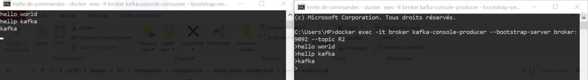

---

## Partie 3 — Kafka avec Spring Cloud Stream

Projet [`kafka-spring-cloud-stream`](kafka-spring-cloud-stream), application sur le port **8090** (le port 8080 étant occupé par Jenkins sur la machine).

### Service Producer via un Rest Controller

`StreamBridge` publie un `PageEvent` dans le topic passé en paramètre.

`GET http://localhost:8090/publish?name=P1&topic=R2`

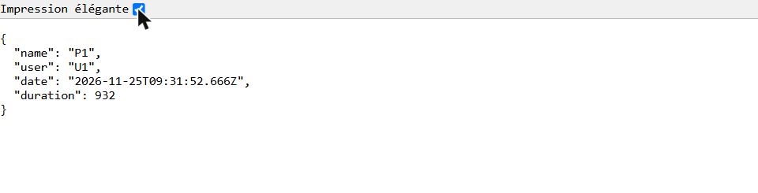

### Service Consumer

Bean `Consumer<PageEvent>` lié au topic R2 (`pageEventConsumer-in-0`). L'événement publié ci-dessus est reçu et affiché :

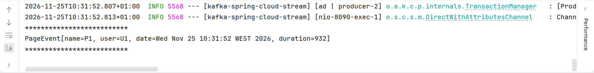

### Service Supplier

Bean `Supplier<PageEvent>` appelé toutes les 200 ms (`poller.fixed-delay=200`), qui envoie des événements aléatoires (pages P1/P2, utilisateurs U1/U2) dans le topic R3 :

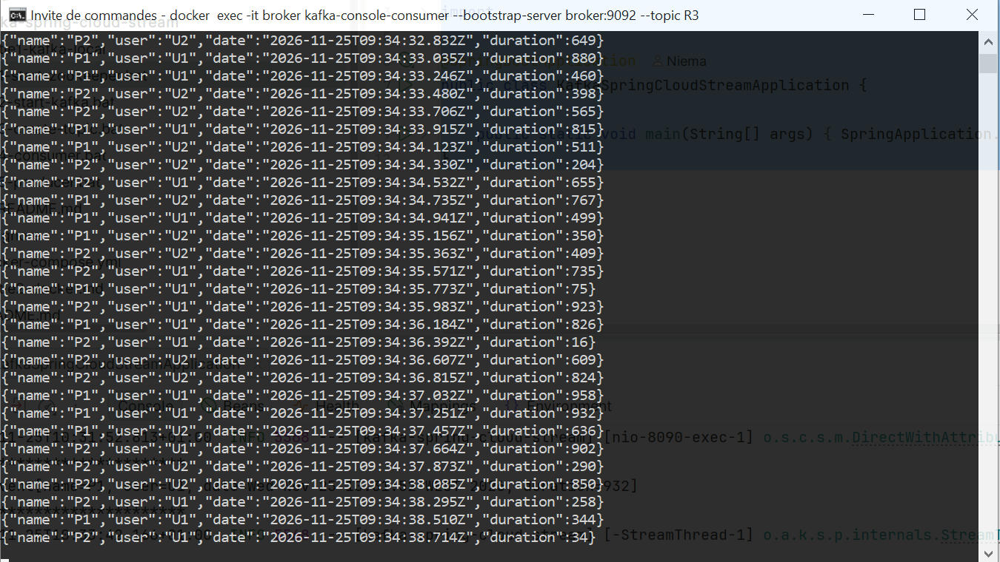

### Data Analytics temps réel avec Kafka Streams

`Function<KStream<String, PageEvent>, KStream<String, Long>>` : lit R3, garde les visites de plus de 100 ms, regroupe par page, compte sur des fenêtres de 5 secondes (store `page-count`) et écrit le résultat dans R4.

```
docker exec -it broker kafka-console-consumer --bootstrap-server broker:9092 --topic R4 --property print.key=true --property key.separator=" : " --value-deserializer org.apache.kafka.common.serialization.LongDeserializer
```

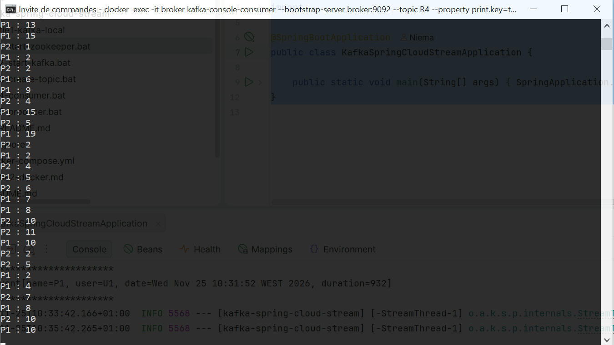

### Application web temps réel

`GET /analytics` interroge chaque seconde le store `page-count` (`InteractiveQueryService`) et envoie le résultat en **Server-Sent Events** :

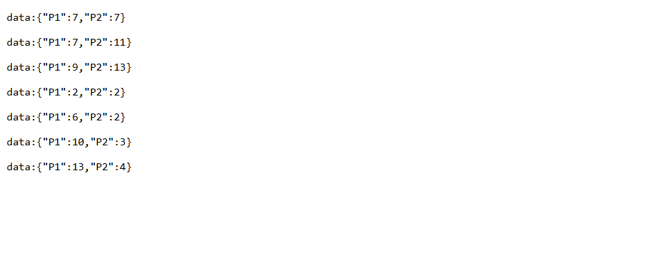

La page `index.html` reçoit ce flux et trace le nombre de visites de P1 et P2 en temps réel :

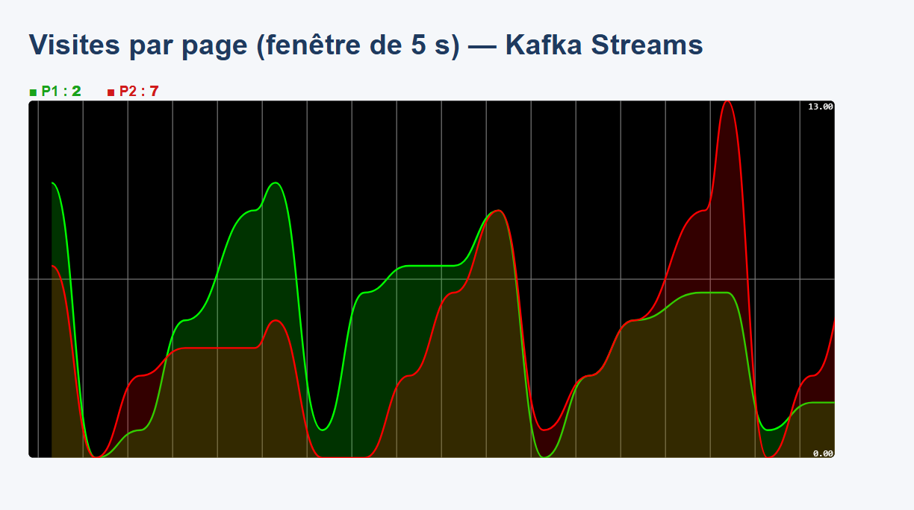

---

## Lancement

1. `docker compose up -d`
2. Lancer `KafkaSpringCloudStreamApplication` (dossier `kafka-spring-cloud-stream`)
3. Ouvrir http://localhost:8090
